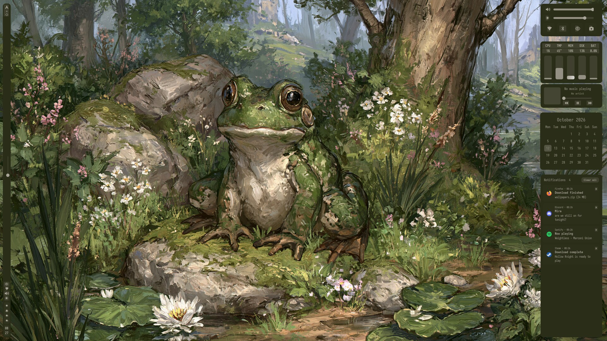
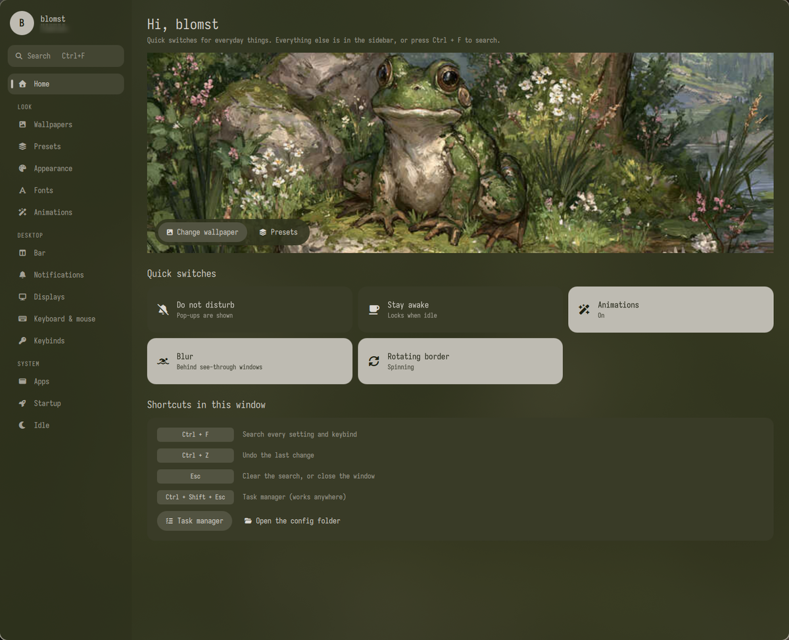
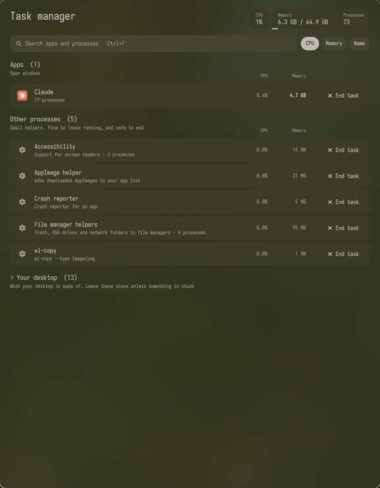
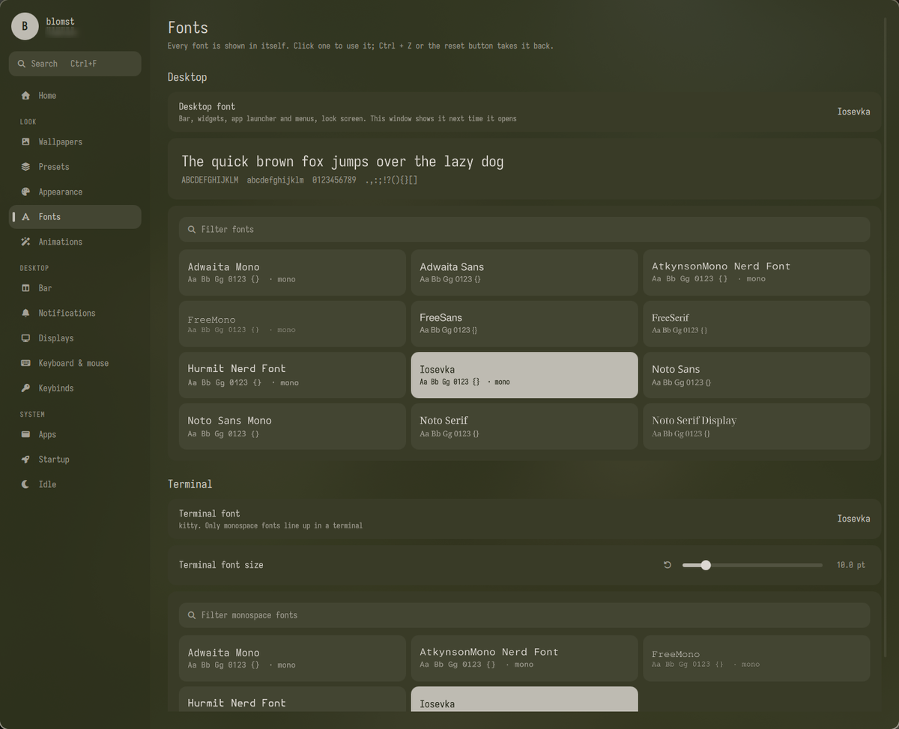
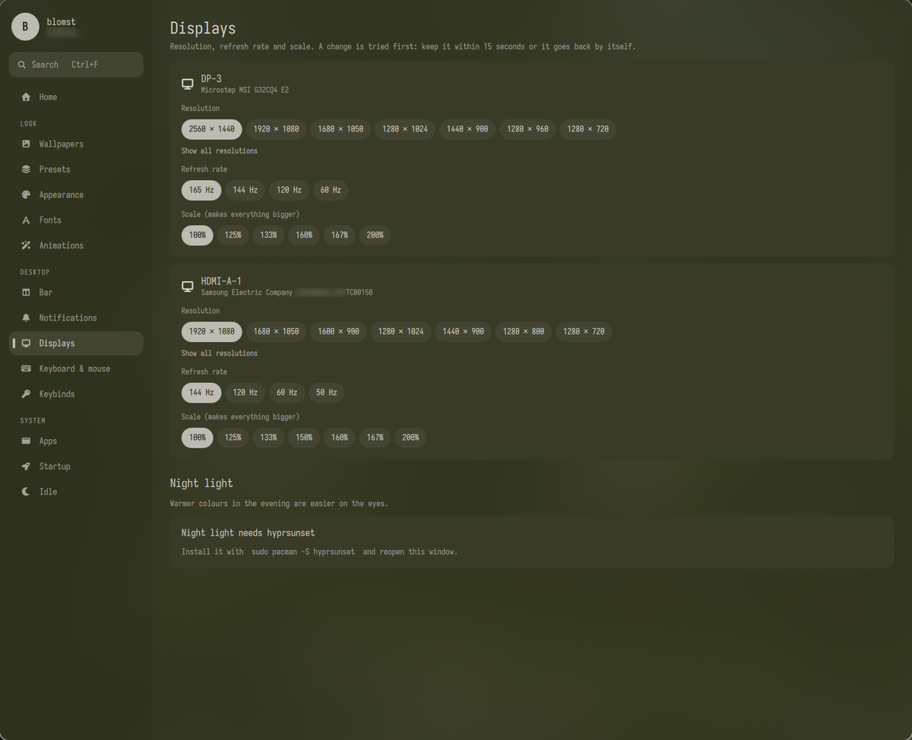
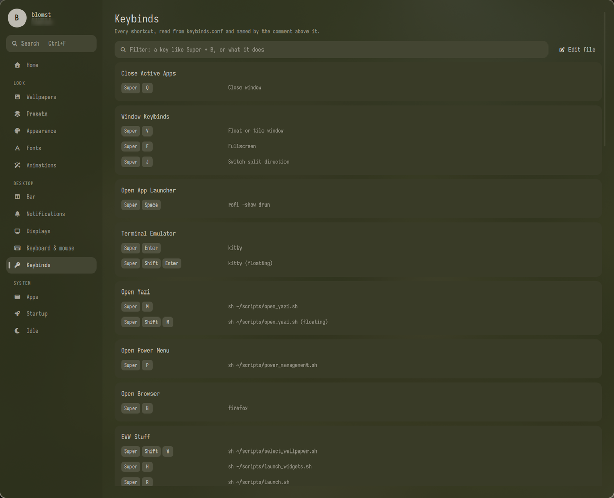
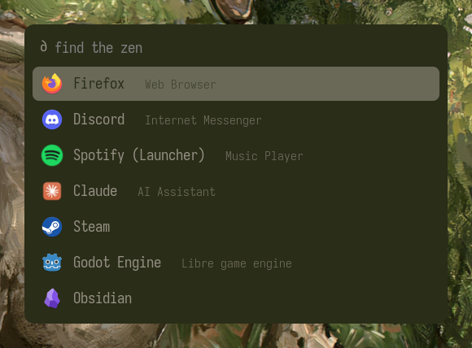
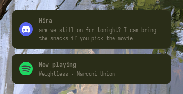

# Blomst

My Hyprland setup on Arch Linux.

It started from the [Zenities](https://github.com/hayyaoe/zenities) rice by hayyaoe and has
since been reworked: blur, shadows and animated borders, new animations, a palette that
follows the wallpaper across the terminal, Hyprland, the lock screen, btop, yazi, GTK apps
and Code - OSS, per-monitor workspaces, live resource rings in the side-bar, and a settings
window.

## Screenshots



| | |
| --- | --- |
|  |  |
| **Settings** (Super + S): quick switches, search with Ctrl + F, undo with Ctrl + Z | **Task manager** (Ctrl + Shift + Esc): what is running, in plain words, and what is safe to end |
|  |  |
| **Fonts**: one font for the bar, menus and lock screen, another for the terminal | **Displays**: resolution, refresh rate and scale, tried for 15 seconds before they stick |
|  |  |
| **Keybinds**: every shortcut, named by its comment in `keybinds.conf` | **App launcher** (Super + Space) with an icon for every app |
|  | |
| **Notifications** in the wallpaper colours; past ones are kept in the notification center | |

## Keys

| Keys | What it does |
| --- | --- |
| Super + S | Settings window (Ctrl + F searches every setting and keybind) |
| Super + H | Widget popups and notification center |
| Super + Shift + W | Wallpaper picker |
| Ctrl + Shift + Esc | Task manager: end apps and processes, like on Windows |
| Super + C | Clipboard history |
| Super + Shift + C | Colour picker: click anywhere to copy its colour |
| Super + Ctrl + Print | Screenshot you can draw on before saving |
| Volume and brightness keys | Change it and show a small pop-up |
| Super + 1 to 5 | Workspace 1 to 5 on the screen the mouse is on |
| Super + Shift + 1 to 5 | Send the focused window to that workspace |
| Super + 6 to 0 | Second screen's workspaces 1 to 5, from anywhere |

Floating windows remember the size and position you give them (per app and kind of window) and reopen that way. Both can be switched off in the settings window.

Notifications pop up in the top right in the wallpaper colours. Super + H also opens a notification
center under the calendar, where past notifications can be read, dismissed one by one or cleared.
Pop-ups hide while it is open, and the history survives restarts (`~/.cache/eww/notification-history.json`).
Do not disturb, how long pop-ups stay and how much history is kept are on the Notifications page of
the settings window.

## Colours everywhere

One wallpaper sets the colours of the bar and widgets, Hyprland's borders, the app launcher,
kitty, GTK and Qt apps, btop, yazi, Code - OSS, the lock screen and the login screen. Firefox and
Discord follow too once their add-ons are set up (below). All colours come from
`.config/matugen/templates/`, and the eww widgets take theirs, plus corner sizes and spacing,
from `.config/eww/scss/tokens.scss`.

### One-time setup for the login screen, Firefox and Discord

These need a password or a browser, so they are not done by `INSTALL.sh`.

- **Login screen**: lets the login screen read the wallpaper and colours (it cannot see your home
  folder), then picks the Blomst theme. The theme then follows every wallpaper change.
  ```bash
  sudo install -d -o "$USER" -g "$USER" -m 755 /var/lib/blomst-sddm
  ~/scripts/sddm_sync.sh
  sudo ln -sfn /var/lib/blomst-sddm/theme /usr/share/sddm/themes/blomst
  sudo mkdir -p /etc/sddm.conf.d && printf '[Theme]\nCurrent=blomst\n' | sudo tee /etc/sddm.conf.d/theme.conf
  ```
- **Firefox**: install `pipx`, then `pipx install pywalfox && pywalfox install`, add the Pywalfox
  extension from addons.mozilla.org and press *Fetch Pywal colors* once.
- **Discord**: install Vencord with its official installer, then turn on the *Blomst* theme under
  Settings > Vencord > Themes.

## What you need

Arch Linux with Hyprland and kitty.

### What `INSTALL.sh` installs

From the Arch repos (pacman):

- **Desktop**: hyprlock, hypridle, hyprpaper, rofi-wayland, xdg-desktop-portal-hyprland,
  xdg-desktop-portal-gtk, gtk3, gtk4, qt6ct, kvantum, qt6-wayland
- **Theming**: matugen, imagemagick, noto-fonts
- **Settings window**: python, pyside6, python-psutil
- **Tools the widgets call**: playerctl, pamixer, brightnessctl, ddcutil, lm_sensors, acpi,
  pavucontrol, curl
- **Terminal apps**: zsh, neovim, yazi, bottom, lua51, lua51-luarocks
- **System**: networkmanager, stow, github-cli
- **Build tools**: base-devel, rustup, go

From the AUR (through yay, which the installer builds first):

- **Bar and widgets**: gtk-layer-shell, libdbusmenu-glib, libdbusmenu-gtk3, python-gobject,
  jq, socat, gvfs, dbus
- **Fonts**: ttf-iosevka, otf-hermit-nerd
- **Terminal**: fastfetch, btop, tmux, zoxide, eza, fzf, nvm,
  zsh-theme-powerlevel10k-git
- **Other**: hyprshot, bluez, bluez-utils, bluez-obex, bluetuith

Built from source: **eww** (the bar and popups).

It expects Hyprland and kitty to be installed already. Clone the repo to `~/blomst` before
running it, since the scripts look for it there:

```sh
git clone https://github.com/blomstt/blomst.git ~/blomst
cd ~/blomst && ./INSTALL.sh
```

Besides packages, the installer also backs up your existing configs to `*.bak-<date>`, links these
dotfiles with stow, makes zsh the default shell, turns on NetworkManager and Bluetooth, and asks
before rebooting. It does not touch your DNS settings. `UNINSTALL.sh` restores only the backups
the installer made.

### Optional extras

No particular apps are required. Some things simply light up if you have them:

- **Music widget**: shows whatever any MPRIS player is playing (via `playerctl`).
- **Code - OSS**: gets the wallpaper palette if it is installed; skipped otherwise.
- **cava, headsetcontrol, LibrePods**: an audio visualizer, wireless headset battery, and AirPods
  battery, noise control and hi-res mic in the side bar. Each one stays hidden until its program is
  installed (and, for LibrePods, running).
- **awww (formerly swww), cliphist, satty, hyprpicker**: animated wallpaper changes, clipboard history,
  drawing on screenshots and the colour picker. Each key tells you what to install if it is missing:
  `sudo pacman -S awww cliphist satty hyprpicker`
- **GTK apps**: follow the palette; older GTK 3 apps need `adw-gtk-theme` for full effect.
- **Night light**: install `hyprsunset` and it appears on the Displays page of the settings window.

Things tied to my hardware that you will want to change:

- `scripts/workspace.sh` names my second monitor (`HDMI-A-1`).
- The brightness slider talks to monitors on DDC buses 5 and 9
  (`.config/eww/scripts/set-brightness.sh` and `get-brightness.sh`).

Extra colour templates for your own machine go in `~/.config/matugen/local.toml`, which is
not tracked.

## Where things live

- `.config/` : the configs themselves, symlinked into `~/.config`
- `scripts/` : helper scripts, symlinked to `~/scripts`
- `settings/` : the settings window (Python and Qt Quick, needs `pyside6`). `backend.py` reads and
  writes the config files, `pages/` holds one file per page and `components/` the shared pieces
- `.config/matugen/templates/` : colour templates, one per themed app

`INSTALL.sh` sets this up on a fresh Arch install and `UNINSTALL.sh` unlinks it again. Both are
adapted from the Zenities installers; read `INSTALL.sh` before running it, since it also changes
your default shell and offers to reboot at the end.
